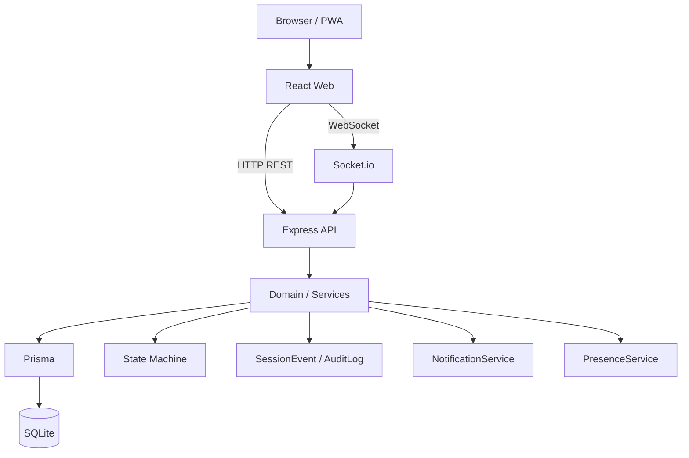
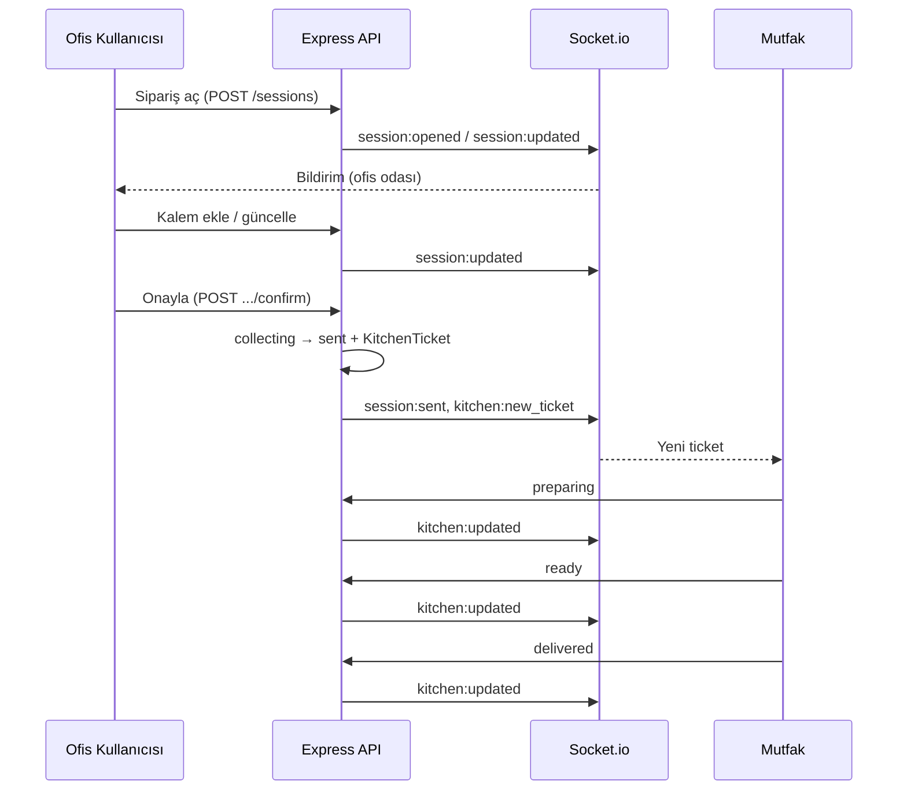

<p align="center">
  
</p>

<h1 align="center">Alfatek Ofis Sipariş Sistemi</h1>

<p align="center">
  Alfatek Ofis Sipariş Sistemi; Teknik Ofis ve Operasyon Ofisi çalışanlarının toplu içecek siparişlerini gerçek zamanlı olarak oluşturmasını, mutfak personelinin siparişleri kolayca yönetmesini sağlayan React PWA + Express tabanlı kurumsal sipariş yönetim sistemidir.
</p>

| | |
| --- | --- |
| **Stack** | React PWA · Express · Prisma/SQLite · Socket.io |
| **Web** | http://localhost:5173 |
| **API** | http://localhost:4000 |
| **Docs** | http://localhost:4000/docs *(yalnızca development)* |
| **CI** | [](https://github.com/YusufSez/AlfatekSiparis/actions/workflows/ci.yml) |
| **Coverage** |  *(placeholder — Codecov/Coveralls bağlanınca güncellenir)* |

---

## Özellikler

- Gerçek zamanlı sipariş yönetimi
- Socket.io canlı bildirimler
- React PWA (mobil kurulabilir)
- Teknik / Operasyon ofisi ayrımı
- Aynı anda tek aktif sipariş (ofis başına)
- Kitchen paneli (new → preparing → ready → delivered)
- Admin paneli (ofis, kullanıcı, menü, ayarlar, loglar)
- Dashboard ve analitik kartlar
- Global Search (kartlı sonuçlar)
- Announcement (duyuru bandı)
- Notification Center
- Session Timeline
- Presence (çoklu sekme desteği)
- State Machine (session + ticket)
- SessionEvent + AuditLog + `requestId`
- Backup / Restore (modüler provider)
- Prometheus Metrics (`/metrics`)
- Health & Version endpointleri
- Swagger UI (development)
- Docker (dev) + Production Docker (multi-stage)
- Test altyapısı (Vitest + Supertest)
- Error Boundary
- Offline banner, skeleton, retry

---

## Ekran Görüntüleri

> Placeholder — görseller `images/` klasörüne eklenecek.

| Ekran | Önizleme |
| ----- | -------- |
| Giriş |  |
| Ofis |  |
| Mutfak |  |
| Admin |  |
| Dashboard |  |
| Mobil |  |

---

## Teknoloji Stack'i

### Frontend

- React
- Vite
- PWA (`vite-plugin-pwa`)
- Socket.io Client

### Backend

- Node.js
- Express (modüler Controller → Domain → Repository)
- Prisma
- SQLite *(PostgreSQL roadmap)*
- Socket.io

### Infrastructure

- Docker & Docker Compose
- Prometheus Metrics
- Swagger / OpenAPI

### Testing

- Vitest
- Supertest
- `@vitest/coverage-v8`

---

## Sistem Mimarisi



Uygulama katmanları:

```text
Controller → Domain → Repository
PresenceService → MemoryPresenceProvider
NotificationService → SocketAdapter
State Machine → session / ticket transitions
```

---

## Proje Yapısı

```text
order/
├── apps/
│   ├── api/
│   │   ├── prisma/              # schema, migrations, seed
│   │   ├── scripts/             # backup.js, restore.js
│   │   ├── src/
│   │   │   ├── common/          # auth, db, metrics, stateMachine, openapi
│   │   │   ├── modules/         # auth, orders, kitchen, admin, menu…
│   │   │   └── realtime/        # socket.io
│   │   └── tests/               # Vitest + Supertest
│   └── web/
│       ├── public/
│       ├── nginx.conf
│       └── src/
│           ├── pages/           # Login, Office, Kitchen, Admin
│           ├── components/      # SearchResults, LoadStates…
│           └── lib/             # api, auth, socket
├── backups/                     # SQLite yedekleri
├── bruno/                       # API örnekleri
├── docs/                        # ek dokümantasyon (opsiyonel)
├── images/                      # README ekran görüntüleri
├── docker-compose.yml           # development
├── docker-compose.prod.yml      # production
├── Dockerfile                   # multi-stage: api + web
└── README.md
```

---

## Kurulum

### 1. Bağımlılıklar

```bash
npm install
cp .env.example .env
```

`.env` içinde en azından `JWT_SECRET`, `DATABASE_URL` ve `CORS_ORIGIN` tanımlayın.

### 2. Veritabanı

```bash
npm run db:setup
```

Bu komut `prisma migrate deploy`, `prisma generate` ve seed çalıştırır.

**Development schema değişikliği:**

```bash
npm run db:migrate:dev
```

**Production / CI:**

```bash
npm run db:migrate
```

> Eski `db push` ile oluşmuş SQLite için bir kez:  
> `cd apps/api && npx prisma migrate resolve --applied 20260727100000_init`

### 3. Geliştirme sunucuları

```bash
npm run dev:api   # 0.0.0.0:4000 — Local + Network URL terminalde
npm run dev:web   # --host :5173 — Local + Network URL terminalde
```

Girişte **Beni hatırla** (varsayılan açık) → 7 gün JWT; kapalıysa `sessionStorage` + 1 gün token.

---

## Telefondan Test

Aynı Wi-Fi üzerindeki telefonlardan geliştirme sunucusunu test etmek için:

### 1. Bilgisayarda sunucuları başlatın

```bash
npm run dev:api
npm run dev:web
```

Vite terminalinde benzer çıktı görünür (HTTPS):

```text
  ➜  Local:   https://localhost:5173/
  ➜  Network: https://192.168.1.42:5173/
```

API terminalinde (HTTP — Vite proxy üzerinden erişilir):

```text
Local   http://localhost:4000
Network http://192.168.1.42:4000
```

### 2. Telefonda Network URL’yi açın

Örnek: `https://192.168.1.42:5173`

İlk açılışta self-signed sertifika uyarısı çıkar — aşağıdaki **Development HTTPS** bölümüne bakın.

Frontend development’ta API ve Socket.io **aynı origin** üzerinden Vite proxy ile `localhost:4000`’e gider (mixed content yok).  
`apps/web/.env` içinde `VITE_API_URL` boş bırakılmalıdır.

### 3. Windows Güvenlik Duvarı

İlk erişimde Windows, Node.js için ağ izni isteyebilir — **özel ağlarda izin verin**.  
Manuel: Gelen kurallarında TCP **5173** ve **4000** portlarını açın.

### 4. Kontrol listesi

| Kontrol | |
| --- | --- |
| Telefon ve PC aynı Wi-Fi’de | ✓ |
| Vite `Network` URL (`https://…:5173`) telefon tarayıcısında | ✓ |
| Sertifika uyarısı kabul edildi | ✓ |
| API `0.0.0.0` dinliyor (`HOST` varsayılan) | ✓ |
| CORS development’ta LAN `*:5173` origin’lerine açık | ✓ |
| Socket.io Vite proxy (`/socket.io`) | ✓ |

Sorun olursa:

1. PC’de `http://<LAN-IP>:4000/health` telefon tarayıcısından açılabiliyor mu?
2. `VITE_API_URL=http://localhost:4000` sabitse kaldırın / boşaltın (HTTPS sayfada mixed content oluşur).
3. VPN / misafir Wi-Fi cihazlar arası izolasyonu kapatın.

---

## Development HTTPS

PWA, Service Worker, `beforeinstallprompt` ve Web Push için tarayıcı **secure context** ister. Development’ta Vite `@vitejs/plugin-basic-ssl` ile HTTPS sunar (`host: true`, port `5173`). Production build etkilenmez.

### Başlatma

```bash
npm run dev:api
npm run dev:web
```

Telefonda: `https://<PC-LAN-IP>:5173` (ör. `https://192.168.1.42:5173`).

### Self-signed sertifika uyarısı

İlk açılışta tarayıcı “bağlantınız özel değil / güvenilir değil” uyarısı gösterir. Bu beklenen davranıştır.

**Android Chrome**

1. Uyarı ekranında **Gelişmiş** / **Advanced**
2. **…adresine git (güvenli değil)** / **Proceed to … (unsafe)** seçin
3. Sayfa yüklendikten sonra Profil → Bildirimler’de Secure Context’in yeşil olduğunu doğrulayın

**iPhone Safari**

1. Uyarıda **Ayrıntıları Göster** / **Show Details**
2. **Bu Web Sitesini Ziyaret Et** / **visit this website**
3. Onaylayın; gerekirse adresi tekrar açın
4. iOS’ta PWA için: Paylaş → **Ana Ekrana Ekle**, uygulamayı oradan açın (Web Push için iOS 16.4+)

### Mixed content

HTTPS frontend, HTTP API’ye doğrudan (`http://IP:4000`) istek atmamalıdır. Development’ta istekler Vite proxy üzerinden gider; `VITE_API_URL` boş kalmalıdır. HTTPS sayfada HTTP `VITE_API_URL` otomatik yok sayılır.

### Doğrulama

Profil → Bildirimler → Debug:

- ✔ Secure Context  
- ✔ Service Worker  
- ✔ PushManager / Notification  
- Manifest `OK`  
- BeforeInstallPrompt: Android’de genelde **Hazır** (kriterler sağlanınca)

Konsol (development): `SW registering…`, `SW registered`, `SW ready`, `Push subscribed`.

---

## Docker

### Development

```bash
docker compose up
```

- Web: http://localhost:5173  
- API: http://localhost:4000  
- Seed + hot reload

### Production

```bash
export JWT_SECRET='uzun-rastgele-secret'
export CORS_ORIGIN='https://siparis.ornek.com'
export VITE_API_URL='https://api.siparis.ornek.com'

docker compose -f docker-compose.prod.yml up -d --build
```

| Özellik | Development | Production |
| ------- | ----------- | ---------- |
| Image | Node bind-mount | Multi-stage (`api` + nginx `web`) |
| `NODE_ENV` | development | `production` |
| `JWT_SECRET` | `docker-dev-secret` | **zorunlu / güçlü** |
| Seed | çalışır | çalışmaz |
| Migrate | `db:setup` | container start: `migrate deploy` |
| Swagger `/docs` | açık | kapalı |

---

## Demo Hesapları

| Kullanıcı | Rol | Ofis |
| --------- | --- | ---- |
| `admin` | Admin | — |
| `mutfak` | Kitchen | — |
| `yusuf` | Office User | Teknik Ofis |
| `ahmet` | Office User | Teknik Ofis |
| `mehmet` | Office User | Teknik Ofis |
| `murat` | Office User | Operasyon Ofisi |
| `veli` | Office User | Operasyon Ofisi |

**Şifre (tümü):** `123456`

> **Uyarı:** Demo hesaplar ve seed yalnızca yerel/geliştirme içindir. Production ortamında kullanılmamalıdır.

---

## Roller

| Rol | Yetkiler |
| --- | -------- |
| **Admin** | Ofis / kullanıcı / menü / ayar CRUD, dashboard, search, loglar, duyurular, presence; kitchen ticket yönetimi; tüm ofisleri görme |
| **Kitchen** | Aktif ticket listesi; durum geçişleri (`preparing` → `ready` → `delivered`); canlı `kitchen:*` eventleri |
| **Office User** | Kendi ofisinde sipariş açma, kalem ekleme/çıkarma, katılma/ayrılma; opener onaylama; ofis presence ve timeline |

---

## Sipariş Akışı



Özet:

```text
Sipariş Aç → Bildirim → Katılım → Onay → Kitchen
  → Hazırlanıyor → Hazır → Teslim
```

Timeout: süre dolunca (ayarlara göre) mutfağa gönderilir veya oturum kapanır.

---

## API

| Grup | Endpoint | Açıklama |
| ---- | -------- | -------- |
| **Auth** | `POST /auth/login` | Giriş (`remember` opsiyonel) |
| | `GET /auth/me` | JWT ile kullanıcı |
| **Sessions** | `GET /sessions/active` | Aktif collecting oturum |
| | `GET /sessions/presence` | Ofis presence |
| | `POST /sessions` | Sipariş aç |
| | `POST /sessions/:id/lines` | Kalem upsert / sil (`qty: 0`) |
| | `POST /sessions/:id/leave` | Siparişten çık |
| | `POST /sessions/:id/confirm` | Mutfağa gönder |
| | `GET /sessions/:id/events` | Timeline |
| **Kitchen** | `GET /kitchen/tickets` | Aktif ticketlar |
| | `PATCH /kitchen/tickets/:id` | Durum güncelle |
| **Notifications** | `GET /notifications` | Bildirim listesi |
| | `POST /notifications/read-all` | Tümünü okundu |
| **Admin** | `GET /admin/dashboard` | Kartlar + grafikler |
| | `GET /admin/search?q=` | Global arama |
| | `/admin/offices`, `/users`, `/menu-items`, `/settings`, `/logs`, `/presence` | Yönetim |
| **Announcements** | `GET /announcements/active` | Aktif duyurular |
| | CRUD `/announcements` | Admin |
| **Menu / Settings** | `GET /menu`, `GET /menu/settings/public` | Menü + public ayarlar |
| **System** | `GET /health` | Sağlık |
| | `GET /version` | Sürüm bilgisi |
| | `GET /metrics` | Prometheus |
| **Docs** | `GET /docs`, `GET /openapi.json` | Swagger *(dev only)* |

Bruno örnek: `bruno/health-login.bru`

---

## Socket Eventleri

| Event | Publisher | Subscriber | Description |
| ----- | --------- | ---------- | ----------- |
| `connected` | API | Client | Bağlantı onayı |
| `session:opened` | API | Office | Yeni sipariş oturumu |
| `session:updated` | API | Office | Kalem / presence güncellemesi |
| `session:sent` | API | Office | Mutfağa gönderildi |
| `session:closed` | API | Office | Oturum kapandı |
| `kitchen:new_ticket` | API | Kitchen / Admin | Yeni ticket |
| `kitchen:updated` | API | Kitchen / Office / Admin | Ticket durumu |
| `presence:update` | API | Office / Admin | Online kullanıcı listesi |
| `notification:new` | API | User | Kullanıcı bildirimi |
| `announcement:updated` | API | Office / Kitchen / Admin | Duyuru yenile |

---

## Ortam Değişkenleri

`.env.example` özeti:

| Değişken | Zorunlu | Örnek / Varsayılan | Açıklama |
| -------- | ------- | ------------------ | -------- |
| `PORT` | hayır | `4000` | API portu |
| `HOST` | hayır | `0.0.0.0` | API bind adresi (LAN için `0.0.0.0`) |
| `NODE_ENV` | prod | `development` / `production` | Ortam |
| `JWT_SECRET` | **prod: evet** | `change-me-in-production` | JWT imza; prod’da zayıf değer → boot reddedilir |
| `DATABASE_URL` | evet | `file:./dev.db` | Prisma bağlantısı |
| `CORS_ORIGIN` | önerilir | `http://localhost:5173` | İzinli origin (virgülle çoklu); **dev’de LAN Vite origin’leri otomatik** |
| `BUILD_DATE` | hayır | — | `/version` |
| `GIT_COMMIT` | hayır | — | `/version` |
| `VITE_API_URL` | web build | *(dev’de boş = Vite proxy)* | Frontend API adresi; HTTPS sayfada HTTP URL yok sayılır |
| `VITE_API_PORT` | hayır | `4000` | (eski) Dev otomatik API portu; proxy kullanıldığında gerekmez |

---

## Test

```bash
npm test
npm run test:coverage
```

| | |
| --- | --- |
| **Araçlar** | Vitest + Supertest |
| **Rapor** | `apps/api/coverage/` |
| **Kapsam** | Auth, state machine, session (açma / 409 / line / confirm / timeout / race), kitchen + socket, NotificationService, Presence (multi-tab), metrics |
| **CI** | Her `push` / `pull_request` → `main` üzerinde GitHub Actions (`.github/workflows/ci.yml`) |

Coverage badge şu an placeholder’dır; Codecov / Coveralls bağlandığında güncellenebilir.

---

## Monitoring

| Endpoint | Format | İçerik |
| -------- | ------ | ------ |
| `GET /health` | JSON | `database`, `socket`, `uptime`, `version` — degraded ise `503` |
| `GET /version` | JSON | sürüm, `NODE_ENV`, Node, DB tipi, commit |
| `GET /metrics` | Prometheus text | uptime, active sessions, online users, today orders/tickets, memory, CPU, event loop delay, request count, avg response time |

Örnek metrikler: `app_uptime_seconds`, `app_active_sessions`, `app_online_users`, `http_requests_total`, `nodejs_eventloop_delay_mean_ms`.

---

## Backup & Restore

### Backup

```bash
npm run backup
# → backups/backup-YYYY-MM-DD-HH-mm.db
```

### Restore

```bash
npm run restore -- backup-2026-07-27-10-00.db
# veya mutlak yol
npm run restore -- C:\path\to\backup.db
```

- Restore öncesi mevcut DB `.pre-restore-<timestamp>` olarak kopyalanır.
- Provider arayüzü: `SqliteBackupProvider` / `SqliteRestoreProvider`
- PostgreSQL için stub: `PostgresBackupProvider` / `PostgresRestoreProvider` (`pg_dump` / `pg_restore` ile genişletilir)

---

## Production Deployment

### Özet adımlar

1. Güçlü `JWT_SECRET` tanımlayın  
2. `CORS_ORIGIN` ve `VITE_API_URL` production origin’leri  
3. HTTPS (PWA zorunlu)  
4. `prisma migrate deploy` (veya prod compose start)  
5. Seed / demo kullanıcı **çalıştırmayın / silin**  
6. `/health`, `/version`, `/metrics` izleyin  
7. Periyodik `npm run backup`  

### Production Checklist

- [ ] HTTPS aktif (PWA)
- [ ] `JWT_SECRET` güçlü ve env’de
- [ ] `NODE_ENV=production`
- [ ] `CORS_ORIGIN` doğru
- [ ] `prisma migrate deploy` uygulandı
- [ ] Seed production’da yok
- [ ] Demo kullanıcılar kaldırıldı / şifreler değiştirildi
- [ ] Swagger `/docs` kapalı (otomatik)
- [ ] Backup cron / schedule
- [ ] Restore prosedürü dokümante ve test edildi
- [ ] `/health` + `/metrics` monitoring’e bağlı
- [ ] Docker production compose kullanılıyor
- [ ] `npm test` yeşil
- [ ] Tek API process veya Redis presence planı

---

## Roadmap

| Sürüm | Hedef |
| ----- | ----- |
| **v1.1** | Redis Presence + Socket.IO adapter (multi-instance) |
| **v1.2** | PostgreSQL + `pg_dump` / `pg_restore` |
| **v1.3** | Mail / Teams / Slack notification adapter’ları |
| **v2.0** | Category, Stock, gelişmiş Analytics |

---

## Lisans

Bu proje Alfatek şirket içi kullanımı için geliştirilmiştir.

**All Rights Reserved.**
